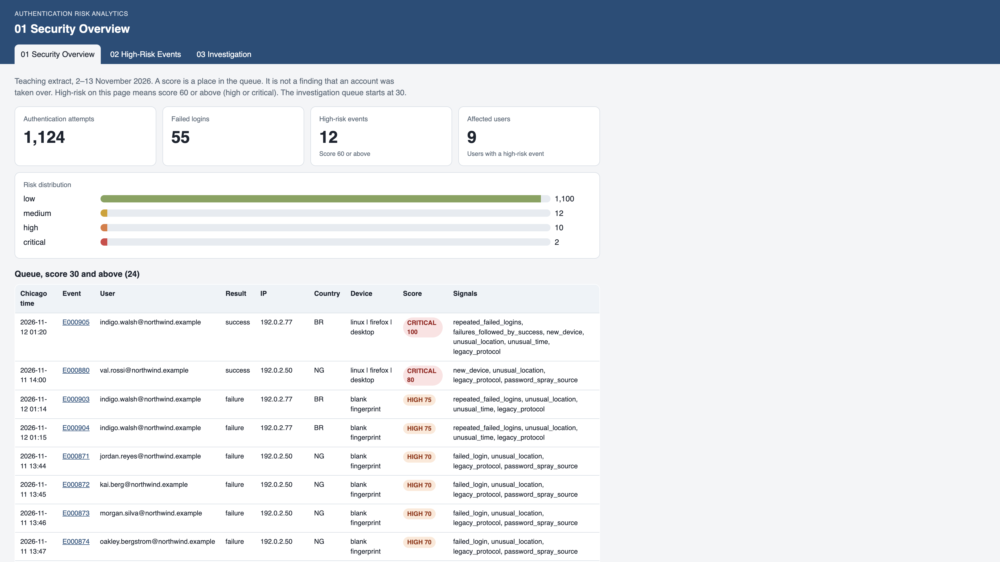
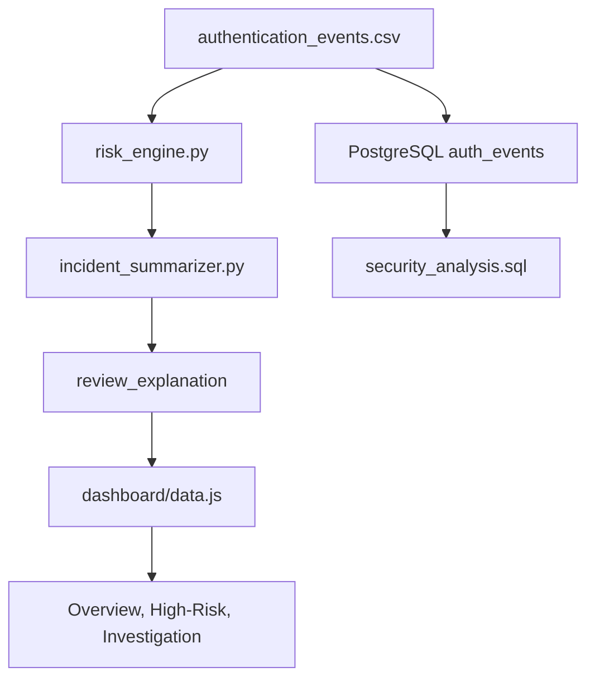
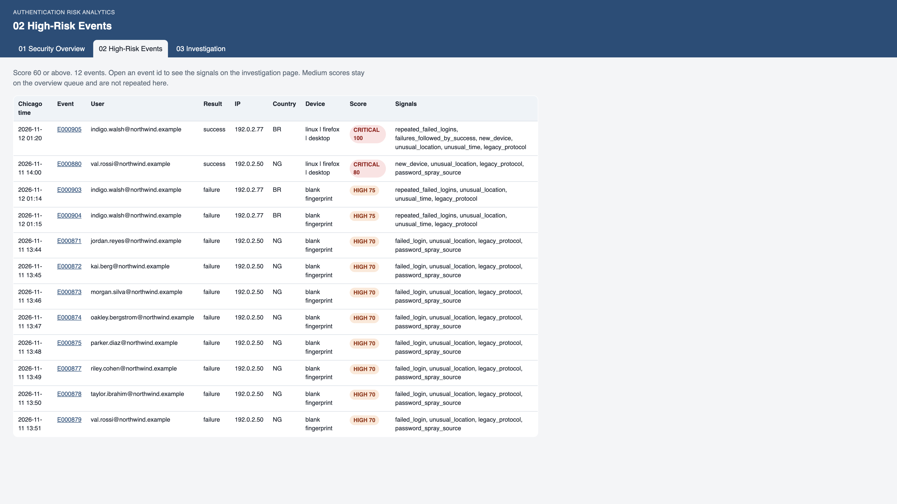
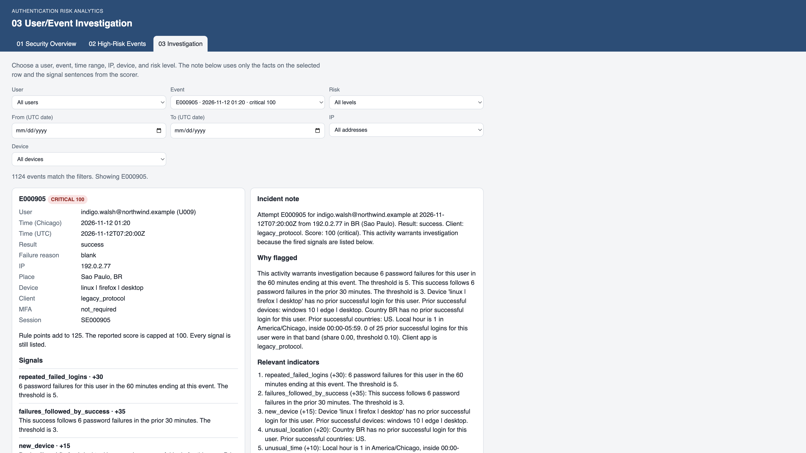

# Authentication risk analytics

Security operations needs a queue for suspicious sign-ins, not a review of every login. This project scores 1,124 attempts with explainable rules, shows the queue on a dashboard, and writes an incident note that says "this activity warrants investigation because..." rather than "this user was hacked."

The file is a seeded teaching extract (2–13 November 2026, 36 employees). Usernames are on `.example`. IP addresses are RFC 5737 documentation ranges. There is no confirmed account-takeover label.



## Result

| | |
| --- | --- |
| Attempts | 1,124 |
| Failed logins | 55 |
| Queue (score 30+) | 24 |
| High-risk (score 60+) | 12 events, 9 users |
| Distribution | 1,100 low, 12 medium, 10 high, 2 critical |

The two critical rows are successes. `E000905` is a legacy sign-in in Sao Paulo after six overnight password failures (rules add to 125, reported score 100). `E000880` is a legacy sign-in in Lagos from an address that had just failed 12 users (score 80).

## Architecture



Python, PostgreSQL, and static HTML. The pages do not rescore. Detail is in [architecture](docs/architecture.md).

## Dashboard

| Page | What it shows |
| --- | --- |
| [01 Security Overview](dashboard/index.html) | Attempts, failures, high-risk events, affected users, risk distribution, the queue |
| [02 High-Risk Events](dashboard/high-risk.html) | The 12 events at score 60 or above |
| [03 Investigation](dashboard/investigate.html) | Filter by user, event, time, IP, device, and risk. Each signal has its points and its sentence |





Open the folder with any static server, for example `python3 -m http.server 8877 --directory dashboard`.

## Reproduce

```bash
python3 -m venv .venv
source .venv/bin/activate
pip install -r requirements.txt
python src/build_dashboard.py
python src/build_evaluation.py
pytest
```

PostgreSQL, optional, for the SQL cuts: `python src/load_events.py` then `psql -d authentication_risk -f sql/security_analysis.sql`. The load checks 1,124 rows, 36 users, 1,069 successes, 55 failures, 1,069 sessions.

## Technology

Python, pandas, PostgreSQL, pytest. The score is rules with fixed points, not a trained model.

## Why rules

An analyst has to recompute a queue placement. This file has no takeover labels to train on. A false high score has a real cost. Changing "five failures" to "eight" is one constant. The longer answer is in [risk model](docs/risk-model.md).

## Limitations

The score is a priority, not a probability, and not proof of a takeover. There is no threat-intel feed and no hardware device id. Off-hours are America/Chicago for every employee. The incident note cannot name a pattern the rules did not already fire. Full list: [limitations](docs/limitations.md). The check on the note: [AI evaluation](docs/ai-security-evaluation.md).

## Layout

| Path | What it is |
| --- | --- |
| `src/risk_engine.py` | `calculate_risk(event, history)` |
| `src/incident_summarizer.py` | The note, and the four checks |
| `src/build_dashboard.py` | Writes `dashboard/data.js` |
| `sql/security_analysis.sql` | Bursts, IP failure rates, hour, new device, new country, failure then success |
| `docs/risk-scenarios.md` | Worked scores |
| `docs/demo-script.md` | Five-minute demo |
| `evaluation/security_scenarios.json` | Six real notes and one rejected loose note |
