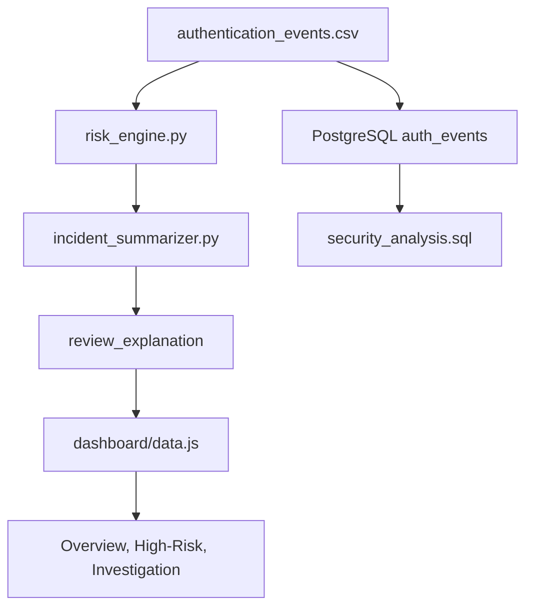

# Architecture

A sign-in row is scored from earlier rows, then shown on a static dashboard. The incident note quotes that score. It does not call an external model.

`calculate_risk` reads one attempt plus earlier attempts and returns a score, a level, and a sentence per fired rule. `summarize_incident` is allowed to use those sentences, the score, and the columns on the row. `review_explanation` rejects a note that invents a fact, states a hack as certain, recommends a company-wide reset, or drops the evidence.

The HTML pages do not rescore. They read `dashboard/data.js`, which `src/build_dashboard.py` writes. PostgreSQL is the same file in table form, used by the SQL detections. The two paths are checked against the same counts: 1,124 attempts, 55 failures, 1,069 sessions.

The queue rule is score 30 and above. High-risk on the dashboard is score 60 and above.
